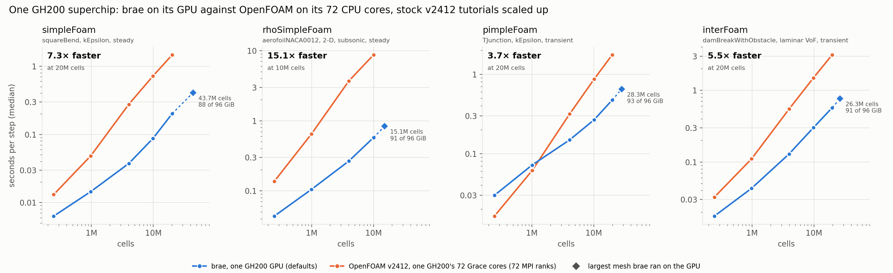

<p align="center">
  
</p>

# brae

OpenFOAM's solvers, re-ported to CUDA. Your OpenFOAM case runs on one NVIDIA GPU, and every solver is checked
against OpenFOAM v2412 itself.

<p>
  
  
  
  
</p>

**[Getting started](docs/getting-started.md) · [Solvers](docs/solvers/) · [Benchmarks](docs/performance.md) ·
[Memory model](docs/memory-model.md) · [Roadmap](docs/roadmap.md) · [Contributing](CONTRIBUTING.md)**

## Quick start

```bash
curl -fsSL https://brae.sh/install.sh | sh
cd yourCase          # 0/  constant/  system/
brae                 # reads controlDict's application and runs that solver
```

An OpenFOAM case goes in and OpenFOAM time directories come out. You don't need an OpenFOAM install or `decomposePar`.

## At a glance

All rows below come from one NVIDIA GH200: brae on its GPU (96 GiB HBM3), OpenFOAM v2412 on its 72 Grace cores
(72 MPI ranks). The cases are stock v2412 tutorials, scaled up by their own `blockMesh`.

| solver | tutorial, scaled | largest mesh on one GH200 | speed at 20 M cells against 72 cores |
|---|---|---|---|
| simpleFoam | squareBend, kEpsilon | **43.7 M cells**, 88 GiB, 0.41 s an iteration | **7.3×** faster |
| rhoSimpleFoam | aerofoilNACA0012, 2-D | **15.1 M cells**, 91 GiB | **15.1×** faster (at 10 M) |
| interFoam | damBreakWithObstacle, VoF | **26.3 M cells**, 91 GiB | **5.5×** faster |
| pimpleFoam | TJunction, kEpsilon | **28.3 M cells**, 93 GiB | **3.7×** faster |

<p align="center">
  
</p>

The method, every mesh size and both codes' timings are in [benchmarks →](docs/performance.md#one-gh200-four-solvers).

## Solvers

Type `brae`. It reads the `application` entry in your `controlDict` and runs the matching solver.

| solver | flow | checked against OpenFOAM v2412 |
|---|---|---|
| [`simpleFoam`](docs/solvers/simplefoam.md) | steady incompressible, RANS | cell by cell, 5 RAS models; motorBike drag within 1.6 % |
| [`pimpleFoam`](docs/solvers/pimplefoam.md) | transient incompressible: URANS, DES, LES | pitzDaily kOmegaSST, U within 0.07 % at t = 0.3 s |
| [`rhoSimpleFoam`](docs/solvers/rhosimplefoam.md) | steady compressible, subsonic and transonic | 5 tutorials as shipped, worst field 5.5e-10 after one iteration |
| [`interFoam`](docs/solvers/interfoam.md) | two-phase VoF: laminar, RAS, LES, moving and refining meshes, waves | all 42 tutorials run to their end time; steps held to serial OpenFOAM field by field |

<details>
<summary><b>Support matrix</b>: turbulence, thermo, schemes, boundary conditions, fvOptions</summary>

<br>

| | supported |
|---|---|
| **turbulence** | kEpsilon · realizableKE · kOmegaSST · kOmegaSSTLM · SpalartAllmaras · Smagorinsky · WALE · SA-DDES/IDDES · kOmegaSST-DDES/IDDES · laminar · generalizedNewtonian |
| **thermo** | hePsiThermo · heRhoThermo · perfectGas · hConst · sutherland · const · liquid (NSRDS correlations, OpenFOAM's own `he→T` inversion) |
| **convection** | upwind · linearUpwind · linearUpwindV · LUST · linear · limitedLinear · limitedLinearV · vanAlbada |
| **pressure–velocity** | SIMPLE · SIMPLEC (`consistent yes`) · PIMPLE · transonic |
| **time** | steadyState · Euler · backward · CrankNicolson |
| **fvOptions** | explicitPorositySource · limitTemperature · fixedTemperatureConstraint · scalarFixedValueConstraint · MRF |

**Boundary conditions**

| | |
|---|---|
| basic | fixedValue · zeroGradient · noSlip · calculated |
| geometric | slip · symmetry · symmetryPlane · wedge · empty |
| coupled | cyclic · cyclicAMI |
| inlet / outlet | inletOutlet · outletInlet · flowRateInletVelocity · surfaceNormalFixedValue · freestream · freestreamVelocity |
| pressure | totalPressure · fixedFluxPressure · pressureInletOutletVelocity |
| time-varying | uniformFixedValue · codedFixedValue · fixedMean |
| turbulence | nutkWallFunction · epsilonWallFunction · omegaWallFunction · kqRWallFunction · turbulentIntensityKineticEnergyInlet · turbulentMixingLengthDissipationRateInlet |
| thermal | externalWallHeatFluxTemperature · limitTemperature |

</details>

Anything not in this matrix stops the run at start-up, and the message names it.

## Supported platforms

| | |
|---|---|
| GPU | NVIDIA Ampere or newer: A100, RTX 30/40/50, L40, H100, GH200, B200, GB200, GB300, GB10 |
| CUDA | 12.4 or newer (13.x recommended) |
| OS | Linux, x86_64 and aarch64 |
| Case | OpenFOAM v2412 format, ASCII or binary, plain or `.gz` |

## How it works

- The mesh and the fields stay on the GPU from the first step to the last.
- The matrices are OpenFOAM's LDU matrices, assembled one thread per cell. simpleFoam and rhoSimpleFoam write
  byte-identical fields run to run, and the test suite holds them to it.
- Whatever linear solver the case names for the pressure equation, brae runs its own AMG-preconditioned conjugate
  gradient there, and the log says so. Every other equation keeps the case's own solver settings.

More: [memory model →](docs/memory-model.md) · [performance and tuning →](docs/performance.md)

## It tells you when it can't

If brae does something other than what your case asked, it says so on stderr:

| prefix | meaning |
|---|---|
| `[ignored]` | your case asked for it; brae does nothing with it |
| `[approximated]` | related but not equal, for example a scheme downgrade or a formula substitution |
| `[defaulted]` | brae could not read a value and fell back to a default |
| `[unread]` | dictionary entries brae never consulted |
| **refusal** | brae stops rather than give a wrong answer |

> A notice means brae gave less than you asked for, but still a defensible answer. A refusal means the answer would
> have been wrong. When in doubt, brae refuses rather than guess.

## Run it

```bash
cd yourCase                       # your OpenFOAM case (0/  constant/  system/)
brae                              # steady, transient or compressible
brae -case /path/to/yourCase      # or from anywhere
brae -partition -case yourCase    # cache mesh + AMG once, later runs start warm
brae -cases coarse medium fine    # one case per GPU, extras queue
brae --help
```

<details>
<summary><b>Build from source</b></summary>

```bash
# deps: cmake >= 3.24, CUDA toolkit, an MPI (OpenMPI), SCOTCH, zlib
git clone https://github.com/simd-ai/brae.git
cd brae
cmake -B build -DCMAKE_CUDA_ARCHITECTURES=<your_arch>
cmake --build build -j 4 --target brae brae_pimpleFoam brae_rhoSimpleFoam brae_interFoam
```

`brae` hands each case to the solver named by its `application` entry, so build all four side by side. Keep `-j`
bounded to about one job per 2 GB of free memory. A bare `-j` starts every compile job at once and runs out of
memory, and the build then stops with only `Error 2`.

| GPU | `<your_arch>` | GPU | `<your_arch>` |
|---|---:|---|---:|
| GB10 | 121 | H100 / GH200 | 90 |
| RTX 50-series | 120 | RTX 40-series / L40 | 89 |
| GB300 / B300 | 103 | RTX 30-series | 86 |
| B200 / GB200 | 100 | A100 | 80 |

</details>

## Limitations

- **One GPU.** The whole mesh must fit in its memory, so a GPU's memory caps the problem size. On a 96 GiB GH200
  that cap is 43.7 M cells for simpleFoam, and 15 M to 28 M cells for the other three solvers (table above).
- **Compressible flow on non-orthogonal meshes.** rhoSimpleFoam's iteration-1 velocity is 2.4e-04 to 3.1e-03 away
  from OpenFOAM's on a 16° mesh, against 1.9e-09 on an orthogonal one. The cause hasn't been found yet.
- **Not bit-identical to OpenFOAM.** The GPU sums in a different order from OpenFOAM, so agreement bottoms out at
  1e-10 to 1e-13 (relative) rather than at zero.
- **pimpleFoam is not yet bit-reproducible run to run.** Two runs of pitzDaily with a pressure reference differ by
  up to 1.4e-08 (relative, U) after 10 steps; simpleFoam and rhoSimpleFoam do not differ at all.

## License

AGPL-3.0. See [LICENSE](LICENSE).
