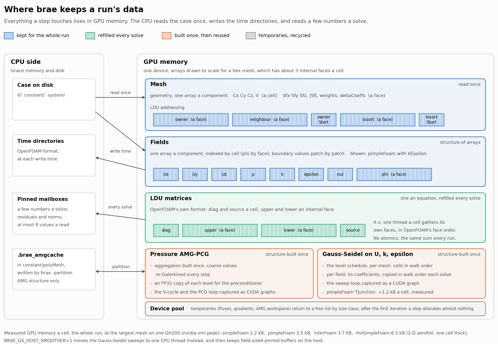

# Memory model and data layout

Why brae lays out its data the way it does, answering the two questions that come up most: *why a device
memory pool instead of pinned memory or `thrust` vectors?* and *why keep OpenFOAM's LDU matrix instead of
converting to CSR for cuSPARSE?*

## Summary

| concern | brae's choice | why |
|---|---|---|
| per-iteration transfers | none (device-resident) | the actual speedup; no migration tax |
| bulk storage | explicit `cudaMalloc`, pooled | makes "0 copies/iter" measurable; kills allocator churn |
| temporaries | caching pool (size-keyed free list) | per-iteration malloc/free churn -> ~0; predictable timing |
| pinned host memory | 2 scalars only (reduction mailbox) | fast single-value sync; not a data store |
| field layout | structure-of-arrays | coalesced access |
| matrix | LDU + cell-gather (not CSR/cuSPARSE) | atomic-free, reproducible, shared addressing; net faster in-solver |
| rebuild costs | AMG hierarchy cache + CUDA-graph replay | reuse across iterations |

**The theme: the speedup is residency, not any allocator trick.** Everything below does the expensive thing once
and reuses it — a device buffer, the AMG hierarchy, a captured CUDA graph.

## The detail

| choice | what | why, measured |
|---|---|---|
| **Explicit device memory, not managed** | `cudaMalloc` behind `DeviceBuffer<T>`, never `cudaMallocManaged` | every host-device copy is a named call, so "0 copies per iteration" is enforceable. Unified memory would hide exactly the transfers being eliminated |
| **The device pool** | `DevicePool` keeps freed blocks in a size-keyed free list (`src/cuda/device_buffer.cuh`) | the loop churns short-lived temporaries — fluxes, gradients, AMG workspace. After iteration 1, steady-state malloc/free drops to **~0**. A/B with `BRAE_NO_DEVICE_POOL=1` |
| **Pinned memory is not the lever** | exactly **2 pinned scalars** (`device_blas.cu`), a reduction mailbox | pinned speeds up host-device transfers; brae's point is not to do them inside the loop. A mailbox for one number, not a data store |
| **No `thrust::device_vector`** | — | same alloc + sync cost the pool removes, and no stable pointer for CUDA-graph capture |
| **LDU + cell-gather, not CSR** | OpenFOAM's format kept; SpMV is one thread per cell | no atomics, no race, **fixed reproducible accumulation order**. cuSPARSE measured and rejected: ~1.3× faster in isolation, **net ~1.25× slower in-solver** — every call must convert LDU→CSR, doubling traffic on a bandwidth-bound kernel, and would not survive graph capture (`validation/perf/spmv_bench.cu`) |
| **Caches beyond the pool** | AMG hierarchy structure serialized and reloaded warm (simpleFoam writes it by default; `-partition` builds it without solving); V-cycle and PCG body captured as CUDA graphs | same "reuse, don't rebuild" idea — and graph replay needs the stable pointers the pool provides |
| **The tradeoff** | cell-gather over an unstructured mesh gives irregular neighbour access | inherent to unstructured FV; renumbering improves locality but does not remove it. Gather won because every stage shares LDU addressing — measured, not assumed |
