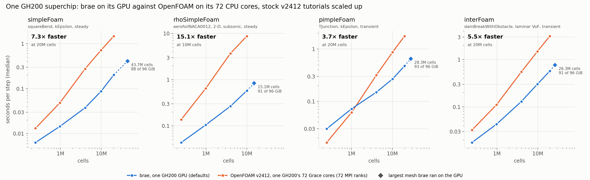

# Performance & tuning

## The one idea: residency

Most GPU approaches offload only the linear solve. The matrix is rebuilt on the CPU and copied to the GPU every
iteration, so assembly, momentum and turbulence stay on one CPU core.

| | where the work runs |
|---|---|
| OpenFOAM + AMGX / PETSc | assembly on CPU, linear solve on GPU, **matrix copied every iteration** |
| SPUMA | GPU fork on unified memory — full residency, no per-iteration copy |
| **brae** | **mesh, fields and every solve stay on the device from first iteration to last** |

## The fast path (on by default)

Two optimisations, both **accuracy-preserving** and **on by default**. Opt out by setting either to `0`.

| flag (default on) | what it does | accuracy |
|---|---|---|
| `BRAE_PCG_DEVICE` | keeps the pressure PCG's Krylov loop resident on the GPU (removes a per-iteration CPU sync) | bit-identical to the host path at iteration 1; same converged state |
| `BRAE_AMG_FP32` | runs the bandwidth-bound multigrid preconditioner in FP32 (half the bytes); the outer solve stays FP64 | bit-identical (mixed precision is confined to the preconditioner) |

Other tuning knobs (advanced; sensible defaults):

| flag | effect |
|---|---|
| `BRAE_AMG_GS=1` | multicolor Gauss-Seidel smoother (vs the default Jacobi), fewer cycles on some anisotropic meshes |
| `BRAE_AMG_TSGS=1` | two-stage Gauss-Seidel (parallel polynomial) smoother, coloring-free |
| `BRAE_AMG_SA=1` | smoothed-aggregation multigrid (vs default pairwise), stronger on cyclic / graded meshes |
| `BRAE_GS_DEVICE=1` | device-resident k/ε Gauss-Seidel scalar solve |

## One GH200, four solvers

Measured 2026-11-18 with brae `main` at df3cd8cb, on one NVIDIA GH200 superchip (96 GiB HBM3 GPU, 72 Grace cores).

| | |
|---|---|
| **brae** | the GPU, with the shell pinned to the same superchip's Grace cores; defaults, apart from the GPU-sweeps rows |
| **OpenFOAM** | v2412, 72 MPI ranks on the 72 Grace cores, scotch decomposition, the case's own linear solvers |
| **cases** | stock v2412 tutorials, scaled by multiplying every block's cell counts in `blockMeshDict` by one factor |
| **both codes** | function objects removed, `residualControl` removed, no writes, fixed `deltaT` (the tutorial's, divided by the scale factor, so the Courant number stays the tutorial's), interFoam's mesh refinement off (`staticFvMesh`) |
| **timed** | the median gap between successive step lines, over steps 11 to 60 (steady) or 11 to 40 (transient). Start-up, mesh reading and the first steps fall outside it, the same way for both codes |
| **largest mesh** | brae only, grown until the GPU's memory is about 95 % full; memory is nvidia-smi's peak during the run |

| solver | cells | brae s/step | OpenFOAM 72 cores s/step | brae against OpenFOAM | brae GPU memory, GiB |
|---|---:|---:|---:|---:|---:|
| simpleFoam | 246,740 | 0.006 | 0.013 | 2.1× faster | 1.1 |
| simpleFoam | 974,980 | 0.014 | 0.048 | 3.3× faster | 2.6 |
| simpleFoam | 4,020,588 | 0.037 | 0.277 | 7.4× faster | 9.0 |
| simpleFoam | 9,909,171 | 0.088 | 0.722 | 8.2× faster | 21.0 |
| simpleFoam | 20,136,713 | 0.202 | 1.472 | 7.3× faster | 42.0 |
| simpleFoam | 43,697,800 (largest) | 0.409 | - | - | 88.0 |
| rhoSimpleFoam | 250,272 | 0.044 | 0.137 | 3.1× faster | 2.1 |
| rhoSimpleFoam | 998,560 | 0.105 | 0.652 | 6.2× faster | 6.6 |
| rhoSimpleFoam | 3,997,400 | 0.267 | 3.705 | 13.9× faster | 24.6 |
| rhoSimpleFoam | 10,000,000 | 0.577 | 8.722 | 15.1× faster | 60.4 |
| rhoSimpleFoam | 15,106,868 (largest) | 0.836 | - | - | 91.3 |
| pimpleFoam | 249,200 | 0.030 | 0.016 | 1.8× slower | 1.4 |
| pimpleFoam | 1,009,664 | 0.072 | 0.061 | 1.2× slower | 3.9 |
| pimpleFoam | 4,073,166 | 0.149 | 0.316 | 2.1× faster | 13.9 |
| pimpleFoam | 10,126,647 | 0.267 | 0.869 | 3.3× faster | 33.3 |
| pimpleFoam | 19,806,488 | 0.474 | 1.760 | 3.7× faster | 64.0 |
| pimpleFoam | 28,292,863 (largest) | 0.652 | - | - | 93.1 |
| pimpleFoam, CPU sweep | 249,200 | 0.044 | 0.016 | 2.7× slower | 1.2 |
| pimpleFoam, CPU sweep | 1,009,664 | 0.181 | 0.061 | 3.0× slower | 2.8 |
| pimpleFoam, CPU sweep | 4,073,166 | 0.754 | 0.316 | 2.4× slower | 9.4 |
| pimpleFoam, CPU sweep | 10,126,647 | 1.919 | 0.869 | 2.2× slower | 22.2 |
| pimpleFoam, CPU sweep | 19,806,488 | 4.484 | 1.760 | 2.5× slower | 41.7 |
| pimpleFoam, CPU sweep | 43,740,928 (largest) | 10.034 | - | - | 89.5 |
| interFoam | 246,447 | 0.018 | 0.032 | 1.8× faster | 1.5 |
| interFoam | 983,858 | 0.043 | 0.111 | 2.6× faster | 4.1 |
| interFoam | 3,958,839 | 0.130 | 0.549 | 4.2× faster | 14.4 |
| interFoam | 9,786,689 | 0.302 | 1.492 | 4.9× faster | 34.1 |
| interFoam | 19,597,259 | 0.572 | 3.127 | 5.5× faster | 66.8 |
| interFoam | 26,309,024 (largest) | 0.766 | - | - | 90.9 |

- **pimpleFoam** sweeps its U, k and epsilon Gauss-Seidel solves on the GPU, level by level, in OpenFOAM's cell
  order. These rows were measured on df3cd8cb with `BRAE_GS_HOST_SMOOTHER=0`, the path that is now the default; a
  re-time on the new default read 0.148 s at 4.1 M cells and 0.466 s at 19.8 M. Below about 2 M cells OpenFOAM is
  still ahead (1.8× at 0.25 M, 1.2× at 1 M).
- **pimpleFoam, CPU sweep** is the old default, now `BRAE_GS_HOST_SMOOTHER=1`: the same sweeps on one CPU thread.
  After 40 steps at 4 M cells it wrote the same U, p, k, epsilon, nut and phi, byte for byte, as the GPU sweeps.
- **rhoSimpleFoam** is the aerofoil, a 2-D mesh one cell thick. On the transonic squareBend, OpenFOAM with 72 ranks
  went to negative temperature within five iterations at every scaled size tried except ×3, where the two codes
  were level (0.272 s and 0.273 s at 3.0 M cells).

## Benchmarks

| | |
|---|---|
| **measured** | total wall for 100 SIMPLE iterations, scaled-pitzDaily |
| **hardware** | one NVIDIA GB10 — 20 Grace cores + one Blackwell GPU, unified LPDDR5x, **no HBM** |
| **excluded, both sides** | one-time prep: `decomposePar` for OpenFOAM, `brae -partition` for brae (caches mesh + AMG, see [Run it](../README.md#run-it)) |

| cells | **brae** (Blackwell GPU) | OpenFOAM (20 Grace cores) | OpenFOAM+AMGX (same GPU) | OpenFOAM+PETSc-GPU (same GPU) | SPUMA (same GPU) |
|---|---:|---:|---:|---:|---:|
| 990k | 21.6 s | 15.9 s | 80.0 s | 89.3 s | 92.4 s |
| 4.89M | 107.7 s | 107.0 s | 572.5 s | 601.6 s | 623.2 s |
| 10.28M | 232.5 s | 228.8 s | 1174.2 s | 1253.0 s | 1056.3 s |
| 14.97M | 339.6 s | 354.4 s | 1696.4 s | 1790.3 s | 1359.3 s |
| 35.6M | 877.1 s | 990.4 s | 4111.0 s | - | —¹ |

SPUMA is the [CINECA / EU-exaFOAM OpenFOAM-GPU port](https://gitlab-hpc.cineca.it/exafoam/spuma) (a full GPU fork
of OpenFOAM on unified memory), the closest full-residency peer to brae. ¹ SPUMA diverged to NaN on the extreme
35.6M scaled mesh at stock solver settings.

**Reading it:**

- **~4-5× faster than every other GPU approach** on the *same* GPU, OpenFOAM's own AMGX/PETSc offloads **and** the
  SPUMA port, at every size, the residency payoff.
- **SPUMA is a full-residency port, not an offload** (a GPU fork of OpenFOAM on unified memory): at ≤5M it is
  roughly tied with AMGX/PETSc, but from ~10M up it *overtakes* them (1056 s vs 1174/1253 at 10.28M) because, like
  brae, it avoids the offloads' per-iteration matrix rebuild-and-copy. It still stays ~4-4.5× behind brae, and its
  GPU sits only ~7-8% utilized at these sizes (its design point is tens of millions of cells per GPU).
- **Parity-to-ahead of a 20-core Grace CPU node**, and the lead grows with mesh size (0.74× at 990k → 1.13× at
  35.6M). Small meshes under-utilize the GPU; large meshes saturate it.

## Why GB10 is a conservative baseline

| | |
|---|---|
| GB10 has **no HBM** | its GPU shares the same ~273 GB/s unified memory as the 20 Grace cores |
| so the GPU **cannot** structurally out-run the CPU there | for a bandwidth-bound solver, parity *is* the ceiling |
| brae clears it at scale anyway | on the most bandwidth-constrained hardware a GPU port can run on |
| on HBM the usable bandwidth is ~10× higher | H100 ~3.3 TB/s, GH200 ~4 TB/s — measured below |

## GH200: the same code on HBM

Same source, **rhoSimpleFoam**, 100 fixed SIMPLE iterations, solver wall only, one GH200 against all 64 Grace cores:

| case | cells | brae | OpenFOAM 64c | SPUMA | vs OF | vs SPUMA |
|---|---:|---:|---:|---:|---:|---:|
| aerofoilNACA0012 | 10,000,000 | 108.2 s | 916.7 s | — | **8.47×** | — |
| aerofoilNACA0012 | 1,024,000 | 11.1 s | 44.5 s | 1495.2 s | 4.00× | **135×** |
| squareBendLiq | 896,000 | 6.8 s | 8.4 s | 92.2 s | 1.24× | **13.6×** |
| squareBend | 112,000 | 1.6 s | 1.8 s | — | 1.14× | — |
| squareBendLiq | 112,000 | 1.7 s | 1.6 s | 22.0 s | 0.92× | **12.9×** |

SPUMA is the [CINECA / EU-exaFOAM OpenFOAM-GPU port](https://gitlab-hpc.cineca.it/exafoam/spuma), the closest
full-residency peer. Two rows are blank because SPUMA was not run at that mesh size, not because it failed.

| | |
|---|---|
| **8.47×** at 10M cells | inside the 8-12× predicted above from the bandwidth ratio alone |
| brae plateaus at **9.2 M cell-iterations/s** | from ~1M cells up |
| **OpenFOAM turns down** past 1M (2.3 -> 1.1) | the widening gap is OpenFOAM losing throughput, not brae gaining it |
| `0.92x` row kept on purpose | below ~10^5 cells a GH200 is not the right tool |
| sm_121 and sm_90 print every digit identical | squareBend, 10 iterations |

### All six tutorials, five codes

| | |
|---|---|
| brae and brae-warm | left of everything, at every size |
| OpenFOAM 64c | the only CPU arm, and the only one close |
| AMGX / PETSc | the offloads — clustered 400-1600 s, the per-iteration matrix rebuild |
| SPUMA | full residency like brae, but 10-100x behind it here |
| timing asymmetry | **brae's wall includes its start-up; OpenFOAM's excludes `decomposePar`** |

Per-case tables: [rhoSimpleFoam on a GH200](../bench/results/rhoSimpleFoam/rhoSimpleFoam_gh200.md).

## Accuracy is not traded for speed

| | |
|---|---|
| fast path vs reference path | identical iteration count, **U 0.016% / p 0.11%** (turbulent pitzDaily) |
| FP32 in the preconditioner | bit-identical — mixed precision never touches the outer double-precision solve |
| brae run to run | **byte-identical** — deterministic reductions, gated by `rho_run_to_run_identity` |
| brae vs OpenFOAM, operator level | **1e-10 to 1e-13** — the GPU sums in a different order |
| brae vs OpenFOAM, 100 iterations | sub-1% — the above compounding through the nonlinear iteration |

Why not bit-identical: [getting-started.md](getting-started.md#why-the-results-are-not-bit-identical).
